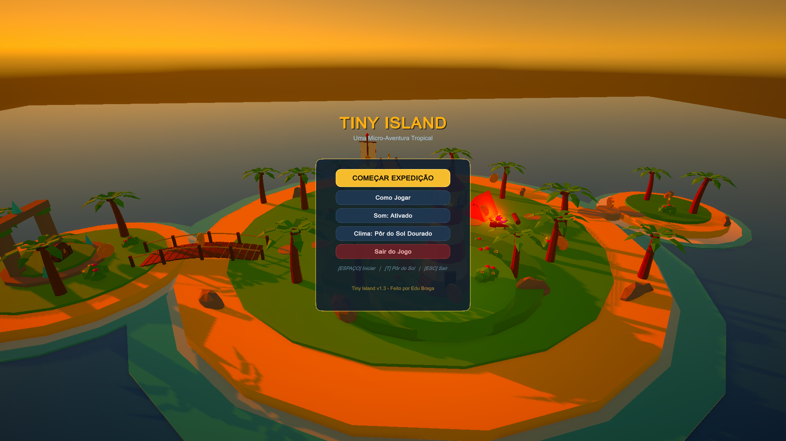
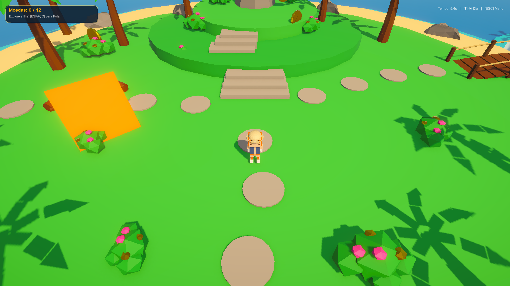

# 🏝️ Tiny Island Game

<div align="center">


**Um micro-jogo aconchegante de exploração 3D (*Cozy Adventure*) em visão isométrica.**

</div>

---

## 📸 Screenshots

<p align="center">
  
  
</p>

---

## 📖 Sobre o Jogo

**Tiny Island** é um protótipo de micro-aventura 3D desenvolvido no **Unity 6**, com modelos 3D autorais gerados proceduralmente no **Blender 5.2** através de uma esteira assistida por IA via **MCP (Model Context Protocol)**.

O objetivo do jogador é explorar um arquipélago tropical paradisíaco (com Farol, Píer, Veleiro ancorado, Acampamento e Ruínas Antigas), apreciar o ambiente e encontrar as **12 Moedas Douradas Perdidas** para destrancar o lendário **Baú do Tesouro**.

---

## 🎮 Mecânicas Principais

* 🏃 **Movimentação Isométrica Fluida:** Controle em 8 direções (WASD / Setas / Gamepad) com aceleração e rotação suave na direção do movimento.
* 🦘 **Pulo Ágil com Coyote Time:** Permite saltar entre pedras da praia, subir no veleiro ancorado e explorar elevações com tolerância de pulo nas bordas.
* 🎥 **Câmera Cinemática de Terceira Pessoa:** Acompanhamento dinâmico suave (*SmoothDamp*) com inclinação em ângulo isométrico e órbita contemplativa em 360° no menu.
* 🌴 **Assets 3D Estilizados (Low Poly):** Palmeiras tropicais curvas, farol, píer, barco, acampamento, ruínas e moedas de ouro 3D com relevo modeladas diretamente via Blender MCP.
* 🪙 **Coletáveis Interativos:** 12 Moedas com animação matemática de rotação e flutuação contínua com detecção de contato por gatilho (*Trigger*).
* 🌊 **Salva-Vidas Aquático (Respawn):** Caso o personagem caia no mar ao redor da ilha, ele retorna suavemente para o centro da praia sem punição.
* ⚡ **Construtor de Cena com 1 Clique:** Script de editor que gera o arquipélago, aplica materiais coloridos do URP, posiciona o jogador, a câmera e os itens automaticamente.

---

## 🕹️ Controles

| Tecla / Comando | Ação |
| :--- | :--- |
| **W / Seta Cima** | Mover para frente (norte da ilha) |
| **S / Seta Baixo** | Mover para trás (sul da ilha) |
| **A / Seta Esquerda** | Mover para a esquerda (oeste da ilha) |
| **D / Seta Direita** | Mover para a direita (leste da ilha) |
| **Espaço / Botão A** | Pular (pedras, colinas e convés do barco) |
| **Analógico Esquerdo** | Movimentação com controle / gamepad |
| **ESC / Start** | Menu de Pausa, Guia de Controles e Opções |

---

## 🛠️ Tecnologias e Arquitetura

```
┌────────────────────────┐      MCP Protocol      ┌────────────────────────┐
│      BLENDER 5.2       │ ◄────────────────────► │    ANTIGRAVITY AI      │
│ (Modelagem Procedural  │                        │ (Assistente & Gestão   │
│   e Exportação FBX)    │                        │     do Projeto)        │
└───────────┬────────────┘                        └───────────┬────────────┘
            │                                                 │
            │ .FBX (Modelos 3D)                               │ C# Scripts / Cena
            ▼                                                 ▼
┌──────────────────────────────────────────────────────────────────────────┐
│                             UNITY 6 (URP)                                │
│          (Física, Iluminação, Gameplay, Câmera e Interface)              │
└──────────────────────────────────────────────────────────────────────────┘
```

### Estrutura do Repositório:
```text
TinyIslandGame/
├── Assets/
│   ├── Editor/
│   │   └── IslandSceneBuilder.cs    # Montador automatizado da cena
│   ├── Materials/                   # Materiais estilizados (Areia, Grama, Água, Ouro)
│   ├── Models/
│   │   ├── Coin.fbx                 # Moeda de ouro 3D modelada no Blender
│   │   └── PalmTree.fbx             # Palmeira tropical 3D modelada no Blender
│   ├── Scenes/
│   │   └── SampleScene.unity        # Cena principal do jogo
│   └── Scripts/
│       ├── CameraFollow.cs          # Controle suave de câmera isométrica
│       ├── CollectibleItem.cs       # Animação e lógica de coleta
│       ├── IslandGameManager.cs     # Gerenciamento de placar e UI
│       └── PlayerController.cs      # Física e movimentação do personagem
├── GDD.md                           # Documento de Game Design de referência
├── ROADMAP.md                       # Planos e melhorias futuras do projeto
├── README.md                        # Apresentação do repositório
└── .gitignore                       # Filtros de arquivos de cache da Unity
```

---

## 🚀 Como Executar o Projeto

1. **Requisitos:**
   * **Unity 6** (versão `6000.0.6f1` ou superior) com suporte a Universal Render Pipeline (URP).
   * **Blender 5.2** (opcional, para expandir a modelagem de novos itens via MCP).

2. **Abrindo o Projeto:**
   * Abra o **Unity Hub** e adicione a pasta deste repositório.
   * Abra a cena em `Assets/Scenes/SampleScene.unity`.
   * Se a cena estiver vazia, basta clicar no menu superior:  
     👉 **`TinyIsland`** > **`🏝️ Construir Ilha Completa`**.
   * Pressione o botão **Play (▶)** no topo da janela do Unity para jogar!

---

## 📋 Documentação Completa
* **Design e Regras do Jogo:** Consulte o [GDD.md](./GDD.md) para ver a especificação completa da versão atual.
* **Planos e Próximas Versões:** Consulte o [ROADMAP.md](./ROADMAP.md) para acompanhar as ideias e melhorias futuras planejadas.
